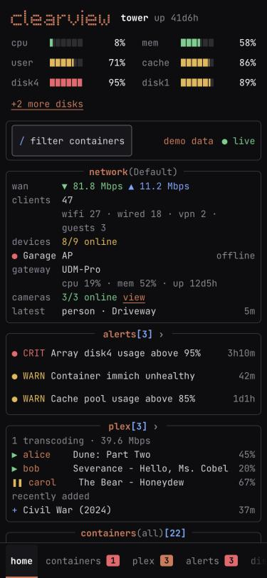
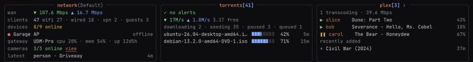

<p align="center">
  
</p>

<h1 align="center">clearview</h1>

<p align="center">
  A terminal-style dashboard for an Unraid homelab.<br>
  Looks like k9s, runs in a browser tab.
</p>

<p align="center">
  
  <br>
  <sub>Demo data. Try it yourself with <code>npm run dev:demo</code>.</sub>
</p>

- **Docker autodiscovery**: every container, its state and health, live CPU and memory use, and a click to open its WebUI
- **Categories**: group containers into sections like Infrastructure and Media
- **Host stats**: CPU, memory and disk usage in the header, with every disk, cache and pool on its own view
- **Network**: UniFi WAN throughput, clients, devices and gateway load
- **Cameras**: UniFi Protect cameras online and the latest person, vehicle or doorbell event
- **Torrents**: Deluge speeds and active downloads, shown while no alerts are firing
- **Alerts**: firing alerts from Grafana
- **Plex**: live streams, transcodes, bandwidth, recently added media, libraries, history and top stats (through Tautulli)
- **Links**: other devices on your network, with an up/down dot
- **Edit settings in the UI**: add links, make categories, rename or hide containers. No config file to touch
- **Themes**: Dracula, Nord, Gruvbox, Tokyo Night, Catppuccin, One Dark, Monokai, Solarized and more, plus your own background and accent colours, previewed live
- **Weather and stocks**: the date, local weather and a small stock ticker in the header
- **Keyboard first**: `j/k`, `/` filter, `:` commands with suggestions and tab completion, `?` help
- **Mouse, touch and screen readers**: a menu on every screen size, sortable columns, an edit button on each container, layouts for phones and tablets, and text colours checked for contrast
- **Your own shortcuts**: press a letter to open a website, for example `y` for YouTube

## Quick start (Unraid)

1. Clone this repo on the server, for example under `/mnt/user/appdata/clearview-src`.
2. Copy `.env.example` to `.env` and fill in what you have. Everything is optional.
3. Run:

   ```bash
   docker compose up -d --build
   ```

4. Open `http://<server>:7878`.

Settings you change in the UI are saved to `/mnt/user/appdata/clearview/clearview.yaml`. That folder must be mounted read-write, which the compose file and the Unraid template already do.

## Install from the Unraid UI (template)

`unraid-template/unraid-template.xml` is an Unraid Docker template. It pulls `ghcr.io/brunolauzon/clearview:latest`, which `.github/workflows/image.yml` builds for amd64 and arm64 on every push to `main`.

One-time setup on GitHub:

1. Push to `main` and wait for the **image** workflow to finish (Actions tab).
2. Open the repo's **Packages**, then **clearview**, then **Package settings**, and set visibility to **Public**. Unraid cannot pull a private package without a login.

Then on the server, pick one:

- **Template repository:** Settings, Docker, Template repositories, add `https://github.com/brunolauzon/clearview`, save. Docker, Add Container, choose **clearview**.
- **Copy the file:**

  ```bash
  wget -O /boot/config/plugins/dockerMan/templates-user/my-clearview.xml \
    https://raw.githubusercontent.com/brunolauzon/clearview/main/unraid-template/unraid-template.xml
  ```

  Then Docker, Add Container, choose **my-clearview** from the template list.

Fill in the server name and, if you want them, the Tautulli, Grafana, UniFi and Deluge fields. The Docker socket and `/mnt` mounts are already set. Apply, then open the WebUI from the container's menu.

Release tags (`git tag v0.1.0 && git push --tags`) also publish `:0.1.0` and `:0.1`. Building on your Mac gives an arm64 image that will not run on an x86 server, so let the workflow build it, or use `docker buildx build --platform linux/amd64`.

## Getting around

The menu under the header lists every view with its number key. A count appears beside a view that has something to report:

| Menu entry | The count is |
|---|---|
| **containers** | containers that are unhealthy, restarting or dead |
| **plex** | streams playing |
| **alerts** | alerts firing (red if any is critical) |
| **disks** | disks at least 90% full |
| **links** | links that are down |
| **cameras** | cameras not connected |

The browser tab's title also starts with the number of firing alerts, for example `(3) tower · clearview`.

- **Mouse and touch:** click a container to open its WebUI, or **edit** on its row to change how it appears. Click the name, state, age, CPU or memory heading to sort the containers by it, and again to go back to categories. A box title with `›` on the home page opens that view.
- **Keyboard:** `:` lists the views as you type (arrows choose, tab completes) and `/` filters the list you are on. Both also have buttons in the bottom bar. See [Keys](#keys).
- **Lost connection:** if the page loses the server, a banner says what time the figures are from, and it reconnects on its own.

### On a phone

On a narrow screen the menu moves to the bottom, the boxes stack, and the containers table keeps the name, state, WebUI link and edit button.

<p align="center">
  
</p>

## Changing settings in the UI

Choose **config** in the menu (or press `7`, or type `:config`). It has six sections; click one, or switch with `[` and `]` (or the left and right arrows):

| Section | What you can do |
|---|---|
| **links** | add, edit and delete devices on your network (`192.168.1.1` is enough: `http://` is added) |
| **categories** | add, edit, delete and reorder categories; pick containers from a list or use `*` wildcards |
| **containers** | containers you have customised: shown-as name, WebUI address, category, hidden |
| **shortcuts** | letters that open a website: add, edit and delete them |
| **general** | the browser tab title, the theme, background and accent colours (previewed as you choose), the weather location and units, and your stock tickers |
| **yaml** | the whole file as text, with validation, for anything the forms do not cover |

Keys: `a` add, `e` or `enter` edit, `d` twice to delete, `K` and `J` move a category up and down, `ctrl-s` saves in **general** and **yaml**. The same actions are buttons. On the containers page, `e` or a row's **edit** button edits that container directly. Leaving a form with unsaved changes asks first.

Changes apply immediately, with no restart, and every open browser tab updates. Each save from a form rewrites the file and keeps the previous version next to it as `clearview.yaml.bak`. Comments you wrote by hand survive only in the **yaml** section, which saves your text exactly as typed.

If you edit the file by hand, clearview notices within a few seconds. If you save from the UI while the file has changed underneath you, the save is refused rather than overwriting your edit. A file with a mistake in it is ignored, the last good settings stay in use, and the config view says what is wrong.

Editing needs the config folder mounted read-write. If it is not writable the view is read-only and says why. If the folder is not a mounted volume at all, edits work but are lost when the container is recreated, and the view warns you. Set `CONFIG_READONLY=1` to turn editing off completely.

## Network (UniFi) and torrents (Deluge)

The home page has three boxes: **network** (with your cameras, if you run Protect), **alerts** (or **torrents**), and **plex**. Host CPU, memory and the most important disks are in the header. The plex box shows what is playing and, in the room that is left, the media added most recently; the plex view (`3`) lists the last ten additions.

While nothing is firing, the middle box shows your torrents (demo data):

<p align="center">
  
</p>

### UniFi

For a UniFi console (UDM, UDR, Cloud Gateway, Cloud Key). It shows WAN download and upload, clients by type, devices online (with the ones that are not), and the gateway's CPU, memory and uptime.

1. In UniFi Network, open **Settings**, **Control Plane**, **Integrations**, and create an API key.
2. Set `UNIFI_URL` (for example `https://192.168.1.1`) and `UNIFI_API_KEY`.
3. Consoles use a self-signed certificate. Clearview refuses it unless you set `UNIFI_INSECURE=1`, which skips certificate checking for UniFi only; a device on your network could then impersonate the console and capture the key.
4. With several sites, set `UNIFI_SITE` to the site's name.

It reads the Network Integration API, which needs a recent UniFi Network version, and it only reads. Device and gateway detection has been checked against a Dream Machine Pro SE.

If something looks wrong, please open an issue. Two things help:

- **No gateway found, or empty WAN numbers**: include the output of `python3 scripts/unifi-check.py https://192.168.1.1` (use your console's address). It asks for the API key without showing it, and prints device models, states, features and uplink rates, with no key, addresses or device names. Like `UNIFI_INSECURE=1`, it does not verify the console's certificate.
- **WAN speed at one eighth of what UniFi shows**: your version reports bytes rather than bits per second. This unit is not yet confirmed.

### Protect cameras

If the same console runs UniFi Protect, the network box also shows how many cameras are online, any that are not, and the latest event. The cameras view (`8` or `:cameras`) lists every camera with its model, what it detects and its last event, followed by recent events: person, vehicle, package, license plate, face, animal, sounds such as a smoke alarm, doorbell rings and plain motion. The latest event prefers something recognised over plain motion.

It needs no settings beyond the UniFi ones above: the same address and API key are used. Set `UNIFI_PROTECT=0` to leave cameras out.

It reads Protect's Integration API and follows its live event feed, and it only reads. That API has no event history, storage use or recording status, so events are those that happen while clearview is running, and they are forgotten when it restarts. Camera pictures are not shown. The camera list has been checked against Protect 7.3.74; event handling follows Ubiquiti's specification for that version. If something is missing, include the output of `python3 scripts/protect-check.py https://192.168.1.1` in an issue: it prints models, states and detection types, with no key, names, addresses or IDs.

### Deluge

Set `DELUGE_URL` (the web UI, for example `http://192.168.1.10:8112`) and `DELUGE_PASSWORD`. The box shows download and upload speed, free space, torrent counts by state and up to three active downloads. Tested with Deluge 2.2.0.

The torrents box replaces the alerts box only while nothing is firing (or Grafana is not configured). If Grafana cannot be reached, the alerts box stays and shows the error. Clearview only reads from Deluge, except that it connects the web UI to its daemon if it is disconnected and there is exactly one.

## Themes and colours

Pick a look in the config view (general). The page previews it as you click, and it is saved in `clearview.yaml`, so every browser and device shows the same thing. Where a scheme's published shade is too faint to read as small text, clearview lightens or darkens it just enough to meet WCAG AA contrast.

| `theme:` | Scheme |
|---|---|
| `clearview` | the default: near-black with orange |
| `dracula` | Dracula |
| `nord` | Nord |
| `gruvbox` | Gruvbox dark |
| `tokyo-night` | Tokyo Night |
| `catppuccin-mocha` | Catppuccin Mocha |
| `one-dark` | One Dark |
| `monokai` | Monokai |
| `solarized-dark` | Solarized dark |
| `solarized-light` | Solarized light |
| `catppuccin-latte` | Catppuccin Latte (light) |

On top of a theme you can set your own background and accent:

```yaml
theme: dracula
background: "#101018"   # optional: replaces the theme's background
accent: "#ff79c6"       # optional: headings, the selected row, highlights
```

Text and surfaces adjust to a custom background; a light background on a dark theme switches to dark text. The picker refuses combinations that would be hard to read. Always quote colours in the file: an unquoted `#` starts a yaml comment, and clearview says so if you forget. Theme values follow each scheme's published palette, with a few secondary shades chosen to fit.

## Weather and stocks

The header shows today's date, and, once you set them in the config view (general), your local weather, with an icon for the current conditions (sun, moon, cloud, fog, drizzle, rain, snow or storm), and up to six stock prices with today's gain or loss. The widget needs a window at least 1200 pixels wide.

```yaml
weather:
  location: "Paris, FR"   # a city, optionally followed by a country or region, or "48.85, 2.35"
  units: metric           # metric (C) or imperial (F)
stocks: [AAPL, ^GSPC, SHOP.TO, BTC-USD]
```

- **Weather** comes from [Open-Meteo](https://open-meteo.com) (no key needed, free for non-commercial use) and refreshes every 10 minutes. A city name is looked up once.
- **Stocks** use Yahoo Finance symbols and refresh every minute. Clearview reads Yahoo's chart endpoint, which needs no key but is **not an official API**: it may change or limit requests without warning, and some exchanges are delayed. Do not rely on it for trading.
- **Privacy:** these are the only internet services clearview talks to; everything else stays on your network. Your server sends the location to Open-Meteo and the symbols to Yahoo, and only when you have configured them. The requests come from the server, not your browser.

## How containers get their WebUI link

Resolved in this order:

1. `clearview.url` label, or an `overrides:` entry in `clearview.yaml`
2. Unraid's own `net.unraid.docker.webui` label. Anything installed from Community Apps already has it. `[IP]` and `[PORT:n]` are expanded. An explicitly empty label means "no WebUI".
3. The first published TCP port (prefers 80, 8080, 8000, 3000, ...; `https` for 443/8443)
4. The container's own LAN address on br0 or macvlan networks

`[IP]` becomes `HOST_IP` if set, otherwise the address you typed into the browser.

Container labels you can add: `clearview.name`, `clearview.url`, `clearview.icon`, `clearview.group`, `clearview.hide=true`.

## Categories

Containers can be grouped into sections (Infrastructure, Media, ...). The containers table shows a heading per category, in the order you list them. Make them in the config view (categories), or write them in `clearview.yaml`:

```yaml
groups:
  Infrastructure: [grafana, prometheus, node-exporter, watchtower, "postgres*", mariadb, redis]
  Media: [plex, tautulli, overseerr]
  Downloads: ["*arr", qbittorrent]
  Home: [home-assistant]
```

- Each entry is a container name. `*` is a wildcard, and matching ignores case. Quote any entry that starts with `*`, because YAML reads a bare `*` as an alias.
- The first category that matches wins, so list specific ones first.
- Containers that match nothing appear under **other**.
- A container's own `clearview.group` label beats these lists, and a `group:` under `containers.overrides` beats both. On Unraid, add the label from the container's edit page with Add another Path, Port, Variable, Label or Device.
- `/media` in the filter matches a category name, `s` cycles the sort (category, name, state, age, cpu, mem), and the group column shows the category when you sort by something else.

## CPU and memory per container

Each running container shows its CPU and memory use, measured the same way as `docker stats`. CPU is a share of one core, so a container using two cores shows about 200%. Memory leaves out reclaimable page cache. Memory turns amber at 70% and red at 90% of the container's limit (or of the server's RAM if it has none). Sort with `s` to find what is using the most.

The numbers refresh every 5 seconds while a browser tab is open, using one lightweight Docker call per running container.

## Configuration

| Variable | Default | Purpose |
|---|---|---|
| `PORT` | `7878` | Listen port |
| `HOST_NAME` | OS hostname | Server name shown in the header |
| `HOST_IP` | browser address | Fills `[IP]` in WebUI links |
| `DOCKER_HOST` | `/var/run/docker.sock` | Socket path or `tcp://host:2375` (socket proxy) |
| `DISKS_ROOT` | `/host/mnt` | Folder whose subfolders are shown as disks |
| `WEB_DIR` | `web/dist` | Folder the web page is served from (the Docker image sets it) |
| `CONFIG_PATH` | `/config/clearview.yaml` | Where UI edits are saved (links, categories, containers, shortcuts, theme, weather, stocks) |
| `CONFIG_READONLY` | unset | `1` turns off editing in the UI |
| `TAUTULLI_URL`, `TAUTULLI_API_KEY` | unset | Enables Plex. Key: Tautulli, Settings, Web Interface |
| `GRAFANA_URL`, `GRAFANA_TOKEN` | unset | Enables alerts. Token: Grafana, Service accounts, Viewer role |
| `GRAFANA_PUBLIC_URL`, `TAUTULLI_PUBLIC_URL` | unset | Browser-reachable address, if different from the one the server uses |
| `UNIFI_URL`, `UNIFI_API_KEY` | unset | Enables the network box (UniFi console) |
| `UNIFI_SITE`, `UNIFI_INSECURE` | unset | Site name; `1` accepts a self-signed certificate |
| `UNIFI_PROTECT` | on | `0` leaves out Protect cameras and events |
| `DELUGE_URL`, `DELUGE_PASSWORD` | unset | Enables torrent stats (Deluge web UI) |
| `CLEARVIEW_DEMO` | unset | `1` serves fake data for trying the UI |
| `CLEARVIEW_DEMO_ALERTS` | `1` | In demo mode, `0` shows a dashboard with nothing firing |

A source with no config shows setup instructions where it would appear. A failing source shows the error and keeps the last good data.

## Keys

| Key | Action |
|---|---|
| `j` `k` `↓` `↑` | move |
| `g` `G` | top, bottom |
| `ctrl-d` `ctrl-u` | half page |
| `enter` `o` or click | open WebUI in a new tab |
| `/` | filter (esc clears) |
| `:` | command: `home` `containers` `plex` `alerts` `disks` `links` `config` `cameras` `help` (arrows choose, tab completes) |
| `e` | edit the selected container (name, address, category, hide) |
| `1`..`8` | jump to a view (7 is the config editor, 8 the cameras) |
| `s` | cycle container sort: category, name, state, age, cpu, mem (or click a column heading) |
| `[` `]` | switch config section |
| `tab` | move between buttons, the menu and lists |
| `esc` | close, clear the filter, or go home |
| `?` | help |
| your own letters | open a website in a new tab (see below) |

### Your own shortcuts

Give a letter a web address and pressing it on the dashboard opens that site in a new tab. Add them in the config view (`:config`, shortcuts), where `youtube.com` is enough, or in `clearview.yaml`, where the address needs `http://` or `https://`:

```yaml
shortcuts:
  y: https://youtube.com
  f: https://facebook.com
  l: https://linkedin.com
  r: https://reddit.com
```

Any single letter works except `a`, `d`, `e`, `g`, `i`, `j`, `k`, `o` and `s`, which the dashboard uses. Shortcuts do nothing while you are typing in a box, or with ctrl, alt or cmd held, so browser shortcuts such as reload keep working. `?` lists yours.

## Development

Needs Node 22.

```bash
npm install
npm run dev:demo     # fake data, no Docker or Unraid needed
CLEARVIEW_DEMO_ALERTS=0 npm run dev:demo   # the same, with nothing firing (shows torrents)
npm run dev          # real data from your local Docker; settings save to config/clearview.yaml
npm run typecheck
npm test
```

`dev` serves the UI on http://localhost:5173 (proxying `/api` to the server on 7878). `npm run build` produces `web/dist` and `server/dist`.

Layout: `shared/` API types and colour themes, `server/src/sources/` one file per data source, `web/src/views/` one file per screen.

## Security

- Clearview has no login. Keep it on your LAN, or put it behind your reverse proxy's auth. Anyone who can open it can also change its settings (links, categories, hidden containers) unless you set `CONFIG_READONLY=1`. Writes are refused unless they come from the page itself, so another website cannot change them through your browser.
- With Protect, anyone who can open the dashboard sees your camera names and when each one detected something. Set `UNIFI_PROTECT=0` if that is more than you want to show.
- Mounting `docker.sock` read-only does not make the Docker API read-only: anything that can reach the socket can control Docker. Clearview only lists and inspects containers and reads their usage statistics. To remove that exposure, run [`tecnativa/docker-socket-proxy`](https://github.com/Tecnativa/docker-socket-proxy) with only `CONTAINERS=1` (and `EVENTS=1`) enabled, and set `DOCKER_HOST=tcp://socket-proxy:2375` instead of mounting the socket.
- API keys, tokens and passwords (Tautulli, Grafana, UniFi, Deluge) stay on the server. They are never sent to the browser or included in error messages.
- Clearview only reads from those services (apart from connecting an idle Deluge web UI to its daemon), but the UniFi key and Deluge password can do more than read. Give clearview its own UniFi key so you can revoke it on its own.

## Not built yet

Container start/stop and logs, disk temperatures and SMART, Unraid array state, pending (not yet firing) Grafana alerts.

## License

[MIT](LICENSE). The bundled JetBrains Mono font is licensed separately under the [SIL Open Font License 1.1](https://github.com/JetBrains/JetBrainsMono/blob/master/OFL.txt).
