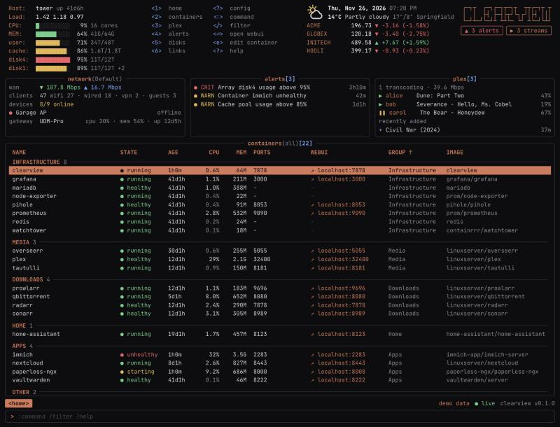

<p align="center">
  
</p>

<h1 align="center">clearview</h1>

<p align="center">
  A terminal-style dashboard for an Unraid homelab.<br>
  Looks like k9s, runs in a browser tab.
</p>

<p align="center">
  
  <br>
  <sub>Demo data. Try it yourself with <code>npm run dev:demo</code>.</sub>
</p>

- **Docker autodiscovery**: every container, its state and health, live CPU and memory use, and a click to open its WebUI
- **Categories**: group containers into sections like Infrastructure and Media
- **Host stats**: CPU, memory, and per-disk usage for the array, cache and pools
- **Alerts**: firing alerts from Grafana
- **Plex**: live streams, transcodes, bandwidth, libraries, history and top stats (through Tautulli)
- **Links**: other devices on your network, with an up/down dot
- **Edit settings in the UI**: add links, make categories, rename or hide containers. No config file to touch
- **Your colour**: pick the accent colour (orange by default) and it applies everywhere, live
- **Keyboard first**: `j/k`, `/` filter, `:` commands with tab completion, `?` help. Mouse and phones work too.

## Quick start (Unraid)

1. Clone this repo on the server, for example under `/mnt/user/appdata/clearview-src`.
2. Copy `.env.example` to `.env` and fill in what you have. Everything is optional.
3. Run:

   ```bash
   docker compose up -d --build
   ```

4. Open `http://<server>:7878`.

Settings you change in the UI are saved to `/mnt/user/appdata/clearview/clearview.yaml`. That folder must be mounted read-write, which the compose file and the Unraid template already do.

## Install from the Unraid UI (template)

`unraid-template/unraid-template.xml` is an Unraid Docker template. It pulls `ghcr.io/brunolauzon/clearview:latest`, which `.github/workflows/image.yml` builds for amd64 and arm64 on every push to `main`.

One-time setup on GitHub:

1. Push to `main` and wait for the **image** workflow to finish (Actions tab).
2. Open the repo's **Packages**, then **clearview**, then **Package settings**, and set visibility to **Public**. Unraid cannot pull a private package without a login.

Then on the server, pick one:

- **Template repository:** Settings, Docker, Template repositories, add `https://github.com/brunolauzon/clearview`, save. Docker, Add Container, choose **clearview**.
- **Copy the file:**

  ```bash
  wget -O /boot/config/plugins/dockerMan/templates-user/my-clearview.xml \
    https://raw.githubusercontent.com/brunolauzon/clearview/main/unraid-template/unraid-template.xml
  ```

  Then Docker, Add Container, choose **my-clearview** from the template list.

Fill in the server name and, if you want them, the Tautulli and Grafana fields. The Docker socket and `/mnt` mounts are already set. Apply, then open the WebUI from the container's menu.

Release tags (`git tag v0.1.0 && git push --tags`) also publish `:0.1.0` and `:0.1`. Building on your Mac gives an arm64 image that will not run on an x86 server, so let the workflow build it, or use `docker buildx build --platform linux/amd64`.

## Changing settings in the UI

Press `7` (or type `:config`) to open the config view. It has five sections, switched with `tab`:

| Section | What you can do |
|---|---|
| **links** | add, edit and delete devices on your network |
| **categories** | add, edit, delete and reorder categories; pick containers from a list or use `*` wildcards |
| **containers** | containers you have customised: shown-as name, WebUI address, category, hidden |
| **general** | the browser tab title and your accent colour: pick a preset, any colour, or type a hex code, and the page previews it as you choose |
| **yaml** | the whole file as text, with validation, for anything the forms do not cover |

Keys: `a` add, `e` or `enter` edit, `d` twice to delete, `K` and `J` move a category up and down. On the containers page, `e` edits the selected container directly.

Changes apply immediately, with no restart, and every open browser tab updates. Each save from a form rewrites the file and keeps the previous version next to it as `clearview.yaml.bak`. Comments you wrote by hand survive only in the **yaml** section, which saves your text exactly as typed.

If you edit the file by hand, clearview notices within a few seconds. If you save from the UI while the file has changed underneath you, the save is refused rather than overwriting your edit. A file with a mistake in it is ignored, the last good settings stay in use, and the config view says what is wrong.

Editing needs the config folder mounted read-write. If it is not writable the view is read-only and says why. If the folder is not a mounted volume at all, edits work but are lost when the container is recreated, and the view warns you. Set `CONFIG_READONLY=1` to turn editing off completely.

## Accent colour

The accent is the colour of headings, the selected row, the active tab and highlights. It is orange until you choose one in the config view (general). It is saved in `clearview.yaml` as `accent: "#3b82f6"`, so every browser and device shows the same colour. Always quote it in the file: an unquoted `#` starts a yaml comment, and clearview says so if you forget. Colours too dark to read on the dark background are refused in the picker. Delete the line, or press **default**, to go back to orange.

## How containers get their WebUI link

Resolved in this order:

1. `clearview.url` label, or an `overrides:` entry in `clearview.yaml`
2. Unraid's own `net.unraid.docker.webui` label. Anything installed from Community Apps already has it. `[IP]` and `[PORT:n]` are expanded. An explicitly empty label means "no WebUI".
3. The first published TCP port (prefers 80, 8080, 8000, 3000, ...; `https` for 443/8443)
4. The container's own LAN address on br0 or macvlan networks

`[IP]` becomes `HOST_IP` if set, otherwise the address you typed into the browser.

Container labels you can add: `clearview.name`, `clearview.url`, `clearview.icon`, `clearview.group`, `clearview.hide=true`.

## Categories

Containers can be grouped into sections (Infrastructure, Media, ...). The containers table shows a heading per category, in the order you list them. Make them in the config view (categories), or write them in `clearview.yaml`:

```yaml
groups:
  Infrastructure: [grafana, prometheus, node-exporter, watchtower, "postgres*", mariadb, redis]
  Media: [plex, tautulli, overseerr]
  Downloads: ["*arr", qbittorrent]
  Home: [home-assistant]
```

- Each entry is a container name. `*` is a wildcard, and matching ignores case. Quote any entry that starts with `*`, because YAML reads a bare `*` as an alias.
- The first category that matches wins, so list specific ones first.
- Containers that match nothing appear under **other**.
- A container's own `clearview.group` label beats these lists, and a `group:` under `containers.overrides` beats both. On Unraid, add the label from the container's edit page with Add another Path, Port, Variable, Label or Device.
- `/media` in the filter matches a category name, `s` cycles the sort (category, name, state, age, cpu, mem), and the group column shows the category when you sort by something else.

## CPU and memory per container

Each running container shows its CPU and memory use, measured the same way as `docker stats`. CPU is a share of one core, so a container using two cores shows about 200%. Memory leaves out reclaimable page cache. Memory turns amber at 70% and red at 90% of the container's limit (or of the server's RAM if it has none). Sort with `s` to find what is using the most.

The numbers refresh every 5 seconds while a browser tab is open, using one lightweight Docker call per running container.

## Configuration

| Variable | Default | Purpose |
|---|---|---|
| `PORT` | `7878` | Listen port |
| `HOST_NAME` | OS hostname | Name in the header and tab title |
| `HOST_IP` | browser address | Fills `[IP]` in WebUI links |
| `DOCKER_HOST` | `/var/run/docker.sock` | Socket path or `tcp://host:2375` (socket proxy) |
| `DISKS_ROOT` | `/host/mnt` | Folder whose subfolders are shown as disks |
| `CONFIG_PATH` | `/config/clearview.yaml` | Where UI edits are saved (links, categories, container settings) |
| `CONFIG_READONLY` | unset | `1` turns off editing in the UI |
| `TAUTULLI_URL`, `TAUTULLI_API_KEY` | unset | Enables Plex. Key: Tautulli, Settings, Web Interface |
| `GRAFANA_URL`, `GRAFANA_TOKEN` | unset | Enables alerts. Token: Grafana, Service accounts, Viewer role |
| `GRAFANA_PUBLIC_URL`, `TAUTULLI_PUBLIC_URL` | unset | Browser-reachable address, if different from the one the server uses |
| `CLEARVIEW_DEMO` | unset | `1` serves fake data for trying the UI |

A source with no config shows setup instructions in its own view. A failing source shows the error and keeps the last good data.

## Keys

| Key | Action |
|---|---|
| `j` `k` `↓` `↑` | move |
| `g` `G` | top, bottom |
| `ctrl-d` `ctrl-u` | half page |
| `enter` `o` or click | open WebUI in a new tab |
| `/` | filter (esc clears) |
| `:` | command: `home` `containers` `plex` `alerts` `disks` `links` `help` (tab completes) |
| `e` | edit the selected container (name, address, category, hide) |
| `1`..`7` | jump to a view (7 is the config editor) |
| `s` | cycle container sort: category, name, state, age, cpu, mem |
| `?` | help |

## Development

Needs Node 22.

```bash
npm install
npm run dev:demo     # fake data, no Docker or Unraid needed
npm run dev          # real data from your local Docker
npm run typecheck
npm test
```

`dev` serves the UI on http://localhost:5173 (proxying `/api` to the server on 7878). `npm run build` produces `web/dist` and `server/dist`.

Layout: `shared/` API types, `server/src/sources/` one file per data source, `web/src/views/` one file per screen.

## Security

- Clearview has no login. Keep it on your LAN, or put it behind your reverse proxy's auth. Anyone who can open it can also change its settings (links, categories, hidden containers) unless you set `CONFIG_READONLY=1`. Writes are refused unless they come from the page itself, so another website cannot change them through your browser.
- Mounting `docker.sock` read-only does not make the Docker API read-only: anything that can reach the socket can control Docker. Clearview only lists and inspects containers. To remove that exposure, run [`tecnativa/docker-socket-proxy`](https://github.com/Tecnativa/docker-socket-proxy) with only `CONTAINERS=1` (and `EVENTS=1`) enabled, and set `DOCKER_HOST=tcp://socket-proxy:2375` instead of mounting the socket.
- API keys and tokens stay on the server. They are never sent to the browser and are stripped from error messages.

## Not built yet

Container start/stop and logs, disk temperatures and SMART, Unraid array state, pending (not yet firing) Grafana alerts.

## License

[MIT](LICENSE). The bundled JetBrains Mono font is licensed separately under the [SIL Open Font License 1.1](https://github.com/JetBrains/JetBrainsMono/blob/master/OFL.txt).
